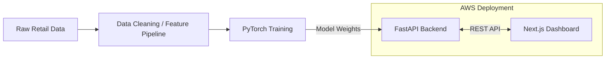

# Velora — E-Commerce Customer Intelligence

[](https://github.com/nithin-kumar-04/Deep-Learning-Microservices-for-E-Commerce-Customer-Analytics-Multi-Task-CLV-and-Churn-Prediction-w/actions/workflows/ci.yml)
[](https://www.python.org/downloads/)
[](https://nextjs.org/)
[](LICENSE)

Velora turns raw e-commerce transactions into retention decisions. It combines a multi-task
PyTorch model (90-day CLV + churn), a neural collaborative-filtering recommender, RFM
segmentation, and a Next.js dashboard for exploring customers, products, and revenue.

## Highlights

- **Multi-task CLV & churn** — shared trunk over scaled RFM features, one regression head and one classification head.
- **NCF recommender** — learned user/item embeddings ranked by affinity, with top-5 recommendations per customer.
- **RFM segmentation** — KMeans clusters mapped to Champions, Loyal Customers, At-Risk VIPs, and Hibernating.
- **Explainability** — exact Shapley contributions for Recency, Frequency, and Monetary.
- **Business overview** — historical monthly revenue plus a 90-day forward forecast.
- **Product analytics** — top products by revenue, quantity, and unique buyers.
- **Batch scoring** — upload a CSV of RFM values and download predictions.
- **Win-back emails** — generated per customer, personalised with their top products.
- **Production-ready plumbing** — API-key auth, CORS allow-list, gzip, cache headers, health/version endpoints, tests, CI, and Docker.

## Architecture



| Model | Task | Approach |
|---|---|---|
| **NCF Recommender** (`src/dl_recommender.py`) | Product recommendations | Neural Collaborative Filtering over `CustomerID` and `StockCode` embeddings |
| **Multi-Task CLV/Churn** (`src/dl_clv_churn.py`) | Customer value & retention | Shared MLP trunk over scaled RFM, branching into CLV regression and churn classification |

## Project structure

```
.
├── api.py                      # FastAPI app: model loading, endpoints, startup precompute
├── run_pipeline.py             # Data prep + both training scripts, end to end
├── download_data.py            # Downloads the raw UCI Online Retail dataset
├── src/
│   ├── data_prep.py            # Cleans raw retail data into a parquet file
│   ├── dl_recommender.py       # NCF model: data prep, training, inference precompute
│   └── dl_clv_churn.py         # Multi-task CLV/churn model
├── tests/                      # Pytest model, data and API tests
├── frontend/                   # Next.js 16 dashboard (static export)
├── terraform/                  # AWS infra: EC2 (API host) + S3 (frontend hosting)
├── Dockerfile                  # API image
├── docker-compose.yml          # API + dashboard
└── .github/workflows/ci.yml    # Lint, tests, frontend build
```

## Quick start

### Prerequisites

- Python 3.11
- Node.js 20+ and npm
- (Optional) Docker Desktop for containers
- (Optional) Terraform + an AWS account for cloud deployment

### 1. Get the data

```bash
python download_data.py
```

This downloads the UCI "Online Retail" dataset to `data/Online Retail.xlsx`.

### 2. Set up the Python environment

```bash
python -m venv venv
source venv/bin/activate        # Windows: venv\Scripts\activate
pip install -r requirements-dev.txt
```

> **Windows note:** if this repository lives under a long path, create the virtualenv on a short
> path instead, e.g. `python -m venv C:\venvs\ecommerce`. Otherwise scikit-learn's compiled
> modules can fail to load with a "filename or extension is too long" error.

### 3. Prepare data and train (optional)

Pre-trained checkpoints already live in `artifacts/`, so you can skip this step unless you want
to retrain:

```bash
python src/data_prep.py     # Clean raw data -> data/cleaned_retail.parquet
python run_pipeline.py      # Train both models -> artifacts/*.pt
```

### 4. Start the API

```bash
cp .env.example .env        # adjust API_KEY if you like
uvicorn api:app --reload --port 8000 --env-file .env
```

Without `--env-file`, the API falls back to the development defaults documented below.

- API: <http://localhost:8000>
- Swagger docs: <http://localhost:8000/docs>

Startup loads the artifacts and precomputes the dashboard caches (segments, at-risk customers,
business overview, product analytics), so the first request is fast.

### 5. Start the dashboard

```bash
cd frontend
cp .env.example .env.local
npm install
npm run dev
```

- Dashboard: <http://localhost:3000>

## Environment variables

### Backend

| Variable | Default | Purpose |
|---|---|---|
| `API_KEY` | `default-secret-key` | Required in the `X-API-Key` header |
| `ALLOWED_ORIGINS` | `http://localhost:3000` | Comma-separated CORS allow-list |
| `LOG_LEVEL` | `INFO` | Python logging level |
| `S3_BUCKET_NAME` | *(empty)* | Optional bucket used to fetch missing artifacts |

### Frontend

| Variable | Default | Purpose |
|---|---|---|
| `NEXT_PUBLIC_API_URL` | `http://localhost:8000` | API base URL |
| `NEXT_PUBLIC_API_KEY` | `default-secret-key` | Key sent with browser requests |
| `NEXT_PUBLIC_SITE_URL` | `http://localhost:3000` | Canonical URL for metadata |

> `NEXT_PUBLIC_*` values are embedded in the browser bundle, so they are not secret. Keep the demo
> key for local use; for production, put the API behind a backend-for-frontend/proxy and issue
> short-lived session credentials instead of shipping a privileged key.

## API reference

Authenticate with the `X-API-Key` header. `/`, `/health`, `/version`, and `/docs` are public.

| Method | Endpoint | Description |
|---|---|---|
| `GET` | `/` | Service metadata |
| `GET` | `/health` | Status, version, uptime, model readiness |
| `GET` | `/version` | App name and version |
| `POST` | `/predict/clv` | CLV + churn for one customer's RFM |
| `POST` | `/explain` | Shapley contributions for the churn prediction |
| `GET` | `/recommend/{customer_id}` | Top-5 NCF recommendations |
| `POST` | `/batch_predict` | Upload `CustomerID,Recency,Frequency,Monetary` CSV |
| `GET` | `/at_risk_customers` | Top 50 customers by churn risk |
| `GET` | `/customer/{customer_id}/rfm` | Cached RFM values for one customer |
| `GET` | `/segments` | Segment summary + scatter sample |
| `GET` | `/business_overview` | Monthly history + 90-day forecast |
| `GET` | `/product_analytics` | Top 20 products by revenue |
| `POST` | `/generate_email/{customer_id}` | Personalised win-back email |

```bash
curl -X POST http://localhost:8000/predict/clv \
  -H "Content-Type: application/json" \
  -H "X-API-Key: default-secret-key" \
  -d '{"recency": 30, "frequency": 8, "monetary": 2500}'
```

```json
{
  "churn_probability": 0.1634,
  "predicted_clv_90d": 1059.5
}
```

## Testing and linting

```bash
ruff check .
pytest

cd frontend
npm run lint
npm run build
```

CI runs the same checks on every push and pull request.

## Docker

Build and run both services:

```bash
cp .env.example .env
docker compose up --build
```

- Dashboard: <http://localhost:3000>
- API: <http://localhost:8000>

Set `API_KEY` and `NEXT_PUBLIC_API_KEY` to the same value so the browser can authenticate.
`artifacts/` and `data/` are mounted from the host, so retraining is reflected without rebuilding.

## Deploying to AWS

Infrastructure lives in `terraform/main.tf`: an EC2 instance for the API and an S3 bucket for the
static dashboard. Terraform is not bundled — install the CLI
(<https://developer.hashicorp.com/terraform/install>) first.

```bash
cd terraform
terraform init
terraform apply
```

Build and sync the dashboard:

```bash
cd frontend
npm run build
aws s3 sync out/ s3://<your-bucket-name>
```

> The Terraform config writes a generated SSH private key to `terraform/ecommerce-key.pem` for EC2
> access. Keep it out of version control (already covered by `*.pem`) and prefer AWS Systems
> Manager Session Manager over SSH.

## Performance notes

- Dashboard caches are computed once at startup, not per request.
- Gzip compression and `Cache-Control: max-age=300` are applied to analytics responses.
- Every response includes an `X-Process-Time-Ms` timing header.
- `node_modules/`, virtualenvs, and Terraform binaries are not committed; a fresh clone is about
  16 MB including models and cleaned data.

## Tech stack

- **ML/Backend:** PyTorch, FastAPI, pandas, scikit-learn, boto3
- **Frontend:** Next.js, React 19, TypeScript, Tailwind CSS, shadcn/ui, Recharts
- **Infrastructure:** Terraform, AWS (EC2, S3), Docker

## License

Released under the [MIT License](LICENSE).
